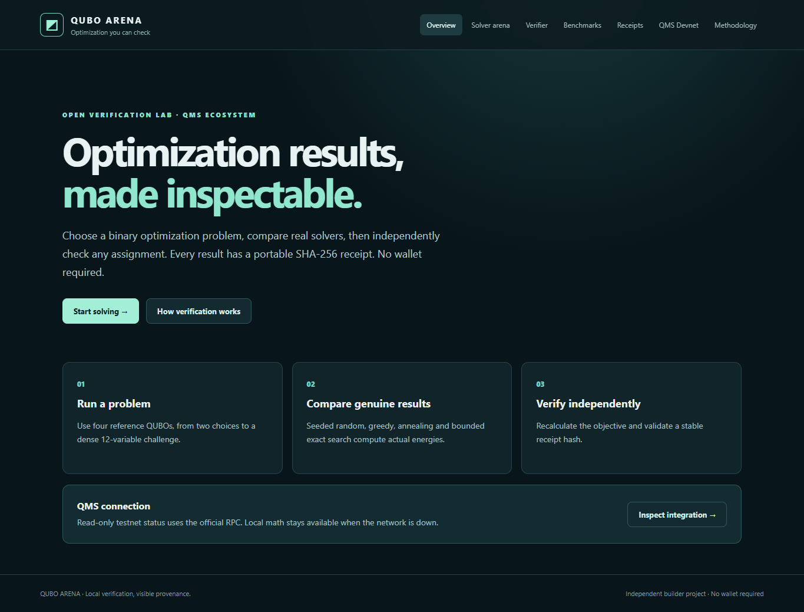
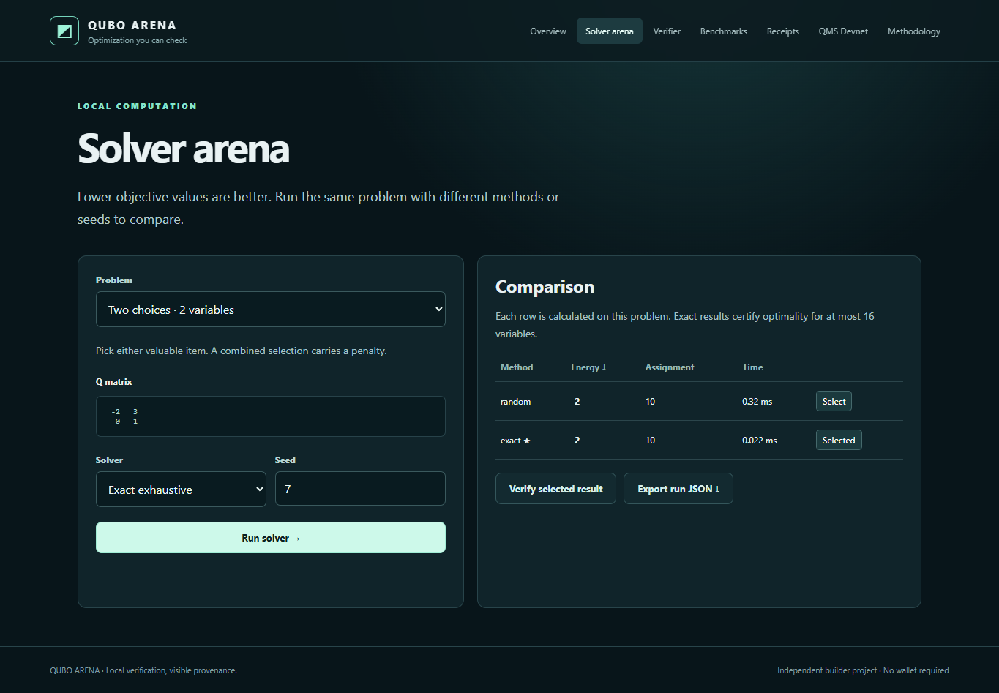

# QUBO Arena

**Reproducible optimization, independently checkable.** QUBO Arena is a wallet-free workbench for comparing binary optimization solvers, checking submitted assignments, and exporting tamper-evident calculation receipts. It also reads QMS Testnet chain identity and the latest block through the official public RPC when reachable.



## Try it

On Windows, from this directory:

```powershell
python -m pip install -r requirements.txt
python -m uvicorn app:app --host 127.0.0.1 --port 8767
```

Open <http://127.0.0.1:8767>. Choose **Start solving**, run seeded random and exact search on *Two choices*, select a result, verify it, export its receipt, and paste it into **Receipts**. The core workflow needs no wallet, keys, or network.



## Features

- Four explained QUBO fixtures with visible matrices; 1–32 variable API validation.
- Seeded random sampling, multi-start greedy local search, simulated annealing, and exact exhaustive search (up to 16 variables).
- Independent objective recomputation, canonical SHA-256 receipts, JSON export, and tamper detection.
- Read-only QMS Testnet RPC adapter with chain-ID validation, `eth_blockNumber`, latest block metadata, 15-second cache, bounded retry, diagnostics, and a QMSScan block link.
- Responsive browser interface and automated acceptance flow.

## Correctness contract

The objective is **minimize** `E(x) = offset + ΣᵢΣⱼ Qᵢⱼ xᵢ xⱼ`, where each supplied matrix entry contributes once. Asymmetric entries are both counted. Reference matrices put interactions in the upper triangle. `math.fsum` is used for summation. Receipts are SHA-256 over sorted, compact, UTF-8 JSON without NaN. A receipt establishes input/energy consistency, not global optimality; only bounded exact search certifies an optimum. Runtime is measured locally and is not deterministic.

## Tests

```powershell
python -m pip install -r requirements-dev.txt
python -m pytest -q --confcutdir . tests
npm.cmd install
node tests/browser_acceptance.mjs
```

The browser test expects the app at port 8767 and Microsoft Edge at the standard Windows path. Screenshots are captured from the running app. See [acceptance report](docs/ACCEPTANCE_REPORT.md).

## Architecture and QMS evidence

FastAPI serves the API and static client; [engine.py](engine.py) owns validation, solvers, scoring, and receipt hashing. [app.py](app.py) isolates the read-only RPC adapter. [Architecture](docs/ARCHITECTURE.md) and [protocol evidence](docs/PROTOCOL_EVIDENCE.md) document the boundaries.

QMS [officially documents](https://docs.qms.finance/for-developers/network-and-rpc) chain ID `19480`, `https://rpc.testnet.qms.finance`, and QMSScan. Its v0.1 explorer displays a QUBO instance hash, winning solution/objective, and Matrix Market download on block pages. Arena links to those pages when live RPC data is available, but does **not** parse or independently verify the explorer's proof format. An RPC outage displays `UNAVAILABLE` with a timestamp and diagnostic; local calculations remain usable. The dated [acceptance report](docs/ACCEPTANCE_REPORT.md) records the current environment's live-verification limit.

## Public deployment

The repository includes [Render's free Python web-service Blueprint](render.yaml) and a `/health` endpoint. [Public release instructions](docs/PUBLIC_RELEASE.md) give the exact GitHub and Render steps, acceptance gate, and current blockers. A published URL is added only after the service is actually deployed and checked.

## Project documents

[User guide](docs/USER_GUIDE.md) · [Demo script](docs/DEMO_SCRIPT.md) · [Builder application draft](docs/BUILDER_APPLICATION.md) · [Teacher lessons](docs/TEACHER_LESSONS.md) · [Roadmap](docs/ROADMAP.md) · [Pulse learning package](learning/PULSE_BUILDER_LESSONS.md)

Independent builder project. Not an official QMS application.
